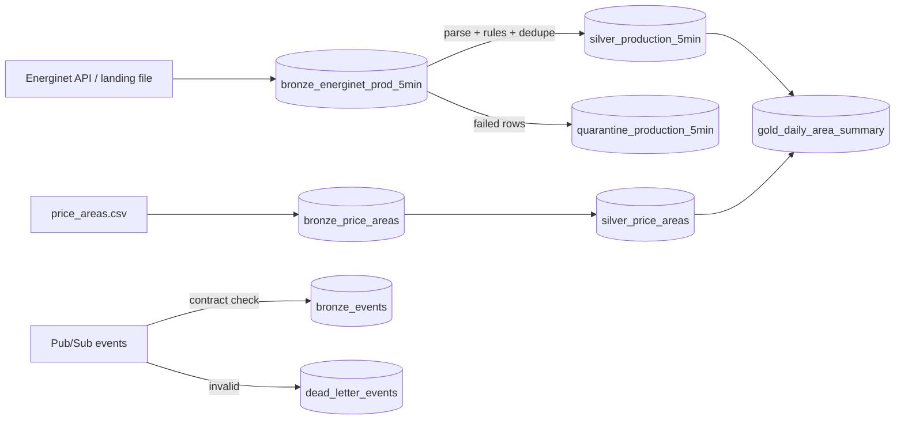

# lakehouse-pipeline-demo

A small medallion pipeline (bronze → silver → gold) in PySpark and Delta Lake, built to learn the
pieces a Data Engineer uses day to day: SQL-first transformations, data quality with quarantine,
lineage, idempotent MERGE, orchestration with partitions, event ingestion with a dead-letter
table, and infrastructure as code. Tests run offline.

It uses Danish electricity data from the Energinet open data API: five-minute power production
for the two Danish price areas, DK1 and DK2.

## What it does

1. **Bronze** lands raw data as it arrived: API records as JSON, and a CSV of price-area names. Each row gets a batch id and an ingest time. A rerun of the same batch replaces that batch's rows.
2. **Silver** parses the JSON with SQL, applies quality rules, removes duplicates, and MERGEs the valid rows keyed by area and interval. Failed rows go to `quarantine_production_5min` with rule names. Nothing is dropped silently.
3. **Gold** is a daily table per area: energy in MWh, renewable share, and completeness (how many of the 288 five-minute intervals arrived). Gold is a MERGE by (day, area).



Full column list and rule table: [docs/data_dictionary.md](docs/data_dictionary.md).

## Run it locally

You need Python 3.12 and Java 17 (set `JAVA_HOME` to a JDK 17 if `java -version` does not show 17).

```bash
python3 -m venv .venv && .venv/bin/pip install -r requirements.txt
make test     # offline: 16 pass, 1 skipped (the Pub/Sub emulator test, see below)
make run      # the saved sample day (1 Nov 2026, UTC) through bronze, silver, gold
```

Local tables use a Derby metastore in `warehouse/`. Derby allows **one JVM at a time**, so run one
Spark job at a time locally.

## Orchestration (Dagster)

Bronze, silver and gold are daily partitioned assets. Partition keys are UTC dates.

```bash
export DAGSTER_HOME=$PWD/.dagster PYTHONPATH=src
.venv/bin/dagster dev -m lakehouse.dagster_defs      # UI at http://localhost:3000
```

- **Sensor:** `landing_sensor` starts a run for each file in `data/landing/` named `energinet_prodex5min_<date>.json`. A changed file (new mtime) gets a new run, which is safe because reruns are idempotent.
- **Asset checks:** `bronze_reconciles` (bronze rows = silver + quarantine, per partition), `silver_keys_unique` (no null or duplicate keys), `day_complete` (warning if an area has fewer than 288 intervals).
- **Backfill a past range:** in the UI, use *Backfill* on `lakehouse_daily` and pick the date range. From the CLI, run one partition at a time:
  ```bash
  .venv/bin/dagster asset materialize -m lakehouse.dagster_defs --select "*" --partition 2026-11-01
  ```
  The CLI refuses partition *ranges* for these assets (they do not use a single-run backfill policy). `dagster job backfill` queues runs that need `dagster-daemon` running, which the UI starts for you.
- **Rerun test:** `tests/test_dagster.py` materializes the same partition twice and checks that bronze, silver, quarantine and gold counts do not change. It also backfills two days.

The job uses the in-process executor. Each step shares one Spark session, because the Derby metastore cannot be opened by several JVMs at once.

## Event ingestion (Pub/Sub emulator)

`src/lakehouse/events.py` validates each message against a versioned JSON contract
(`src/lakehouse/contracts/energinet_production_event.v1.json`):

- A message that is not JSON, has an unsupported `schema_version`, breaks the contract, or has a bad timestamp goes to `dead_letter_events` with the reason.
- Valid messages go to `bronze_events`, one row per `event_id`. Redelivery (same message, or a producer retry with the same `event_id`) is counted as a duplicate and not written again.
- `src/lakehouse/pubsub.py` pulls from a subscription and acknowledges only after the batch is committed. If the job fails first, Pub/Sub redelivers.

Run the emulator (needs Docker running; no Google account):

```bash
docker compose up -d
export PUBSUB_EMULATOR_HOST=localhost:8085
make test     # now also runs tests/test_pubsub_emulator.py
```

**Status:** the contract, validation, dead-letter and dedupe tests run locally, and they are part of the offline suite that the CI `test` job runs (green in [run 41482881857](https://github.com/Deleuzy/lakehouse-pipeline-demo/actions/runs/41482881857)). The emulator test ran locally against the Docker container and is skipped in CI.

### Azure equivalents

| This repo | Azure | Notes |
|---|---|---|
| Pub/Sub topic and subscription | Event Hubs (event stream, consumer groups) or Service Bus topic and subscription (messaging) | Pub/Sub acknowledgement maps to Service Bus complete, Event Hubs checkpoint. |
| `dead_letter_events` | Service Bus dead-letter queue | Service Bus has one built in; here it is a table so the reason is queryable. |
| Versioned JSON contract | Event Hubs Schema Registry, or a contract file in the repo | The check here runs in the consumer. |
| `gold` schema grants | Unity Catalog `GRANT` on the schema | Needs a premium workspace (see Azure below). |
| Dagster daily partitions | Data Factory triggers and tumbling windows | Dagster's partition key is the same idea as an ADF window. |

## Azure deployment (Terraform)

Everything is in `infra/`: resource group, ADLS Gen2 storage with `bronze`, `silver` and `gold`
containers, a Data Factory with a pipeline (copy from the Energinet API into bronze, then run the
Databricks job), a Databricks workspace and job, and optional Unity Catalog grants.

**Status: `terraform fmt -check` and `terraform validate` pass (Terraform 1.17.1, azurerm 4.x and databricks 1.x providers, no credentials). tflint passes. Nothing has been applied to an Azure subscription.**
CI runs `terraform fmt -check`, `terraform init -backend=false` plus `validate`, and `tflint`. It
uses no credentials and never runs `apply`.

Steps to deploy on a **free Azure account** (you run these yourself; nothing here creates an account):

1. Install Terraform 1.6 or later and the Azure CLI (`az`).
2. `az login`, then `az account show` to confirm the subscription.
3. `cd infra && cp terraform.tfvars.example terraform.tfvars` and review it. Keep `databricks_sku = "standard"` and `enable_unity_catalog = false` on a free account.
4. `terraform init`, then `terraform plan -out tfplan`. Read the plan before applying.
5. `terraform apply tfplan`.
6. Terraform uploads the notebook and the code and data it reads to `var.workspace_root` (default `/Shared/lakehouse-pipeline`) in the new workspace. Nothing to import by hand.
7. In the Data Factory studio, open `pl_energinet_to_lakehouse` and click **Debug**. Check the copy and the Databricks job each succeed.
8. **When finished:** `terraform destroy`. Check the portal afterwards: the Databricks managed resource group `rg-lakehouse-dbw-managed` is removed with the workspace.

**Cost notes.** Storage at LRS, Data Factory activity runs and a short Databricks job are small, but they are billed. Databricks bills compute while the job runs. Unity Catalog needs the premium tier, which costs more than standard. Check the Azure pricing calculator before `apply`, and destroy the stack as soon as you are done. Do not leave it running.

**Known gaps in the Terraform (not checked on Azure):**
- `validate` checks the schema and the argument rules, not what Azure accepts at apply time. Nothing has been deployed.
- The Databricks linked service uses a fixed runtime (`15.4.x-scala2.12`) and VM size (`Standard_DS3_v2`). Check both are still offered in your region before `apply`.
- The copy activity writes one JSON file per run to a fixed path. The pipeline does not yet pass the partition date, so a daily pipeline overwrites it.
- Unity Catalog grants are written as an example and gated off (`enable_unity_catalog`). They need a metastore attached to a premium workspace.

## Status: what ran where

| Check | Where it ran | Result |
|---|---|---|
| Offline tests (`make test`) | Local, macOS, Python 3.12, Java 17 | 14 passed, 1 skipped (the emulator test) |
| Offline tests | GitHub Actions `test` job ([run 41482881857](https://github.com/Deleuzy/lakehouse-pipeline-demo/actions/runs/41482881857)) | 16 passed, 1 skipped (latest run 41485677850); pipeline smoke run: 576 silver, 0 quarantined |
| Pub/Sub emulator test | Local, Docker Desktop, emulator container | 1 passed (run once, then the container was stopped) |
| Pipeline on the saved sample (`make run`) | Local | 576 bronze, 576 silver, 0 quarantined, 0 incomplete area-days |
| Dagster definitions and one partition | Local, CLI (`dagster asset materialize`) | Run succeeded; reruns leave counts unchanged (tested) |
| Terraform `fmt -check`, `init -backend=false`, `validate` | Local (Terraform 1.17.1) and GitHub Actions `infra` job (same run) | Pass; no credentials used |
| tflint with the azurerm ruleset | Local and GitHub Actions `infra` job | Pass |
| Azure deployment | Nothing | **Not deployed.** No `terraform apply` has run, and no Azure resources exist. |
| Databricks notebook | Nothing | **Not run.** |

The emulator test is skipped in CI because the Pub/Sub emulator is not started there. Locally it runs with `docker compose up -d` and `PUBSUB_EMULATOR_HOST`.

Other limits: the Pub/Sub adapter has been exercised only against the emulator, not Google Cloud. The Terraform has been validated against the provider schema, not applied, so Azure may still reject some values at apply time.

## Limits

- The renewable share counts wind and solar only. The feed does not separate other renewables, so it is a lower bound.
- The feed has no publish time, so late data cannot be detected. Missing intervals show up in completeness.
- Gold is rebuilt per day from silver. The Dagster backfill for past dates needs the landing file for each date.
